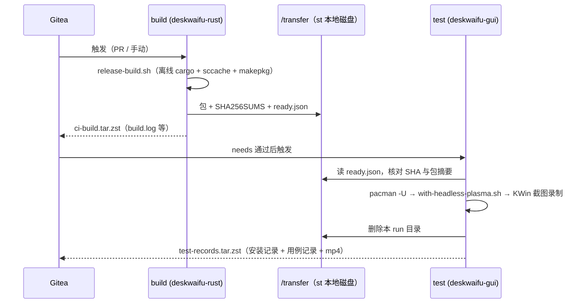

# CI 流水线改造：构建并打包 → 安装包验收

## 1. 目标

把 [ci.yml](../.gitea/workflows/ci.yml) 从「三个并行构建作业 + 一个汇总作业」改为**两个串行作业**：

| 作业 | runner 标签 | 职责 | 产物 |
| --- | --- | --- | --- |
| `build`（构建并打包） | `deskwaifu-rust` | 编译整个工作区并打出 Arch 包 | 包写入共享目录 `/transfer`；`ci-build`：构建日志 + 校验和 |
| `test`（安装包验收） | `deskwaifu-gui` | 安装上一步的包，在无头 Plasma 中跑验收用例 | `test-records`：安装日志 + 用例记录（含 15 fps H.265 视频） |

改造后的流水线是**「对交付物做验收」**而不是「对源码做检查」：`test` 作业只接触安装后的文件，不接触 `target/`、不编译 Rust。本次只保留一个用例（GUI 面板开关），但测试入口按可扩展的用例框架实现，后续把其它验收项逐个加进去，`ci.yml` 不再改动。

### 非目标

- 不恢复 `cargo fmt` / Clippy / 工作区单测的 CI 门禁（见 §7 的迁移边界）。
- 不改 runner 镜像、不改 makepkg 流程、不改发版工作流。
- 不恢复 PR 自动审查流水线；仓库只保留 CI 与人工评审。
- 不为 CI 流程新增断言测试：不解析 `ci.yml`、`Containerfile` 文本，也不为上报载荷写契约测试。流水线是否按设计工作，以线上运行本身为唯一验收。

### 完成标准

1. PR 上出现两个作业，`test` 依赖 `build`，两者不同 runner。
2. `build` 失败时 `test` 不执行；`build` 成功时 `test` 通过共享目录拿到同一个提交的包，且握手校验通过。
3. 每个作业的日志与测试记录从运行页可下载，失败时也上传已产生的那部分；软件包不进入 artifact 存储。
4. 每次 PR run 最多一次 OpenHands 失败回调。
5. 仓库不再保留断言 CI 结构、sccache 包装脚本行为与回调载荷的测试；其余测试仍可通过。

---

## 2. 总体结构

```
                 PR opened/reopened/synchronize · dispatch（PR 阶段）
                                   │
                                   ▼
                      ┌───────────────────────┐
                      │ ci.yml                │
                      │ deskwaifu-rust        │
                      │ ┌───────────────────┐ │
                      │ │ build             │ │
                      │ │  release-build.sh │ │
                      │ │  → .pkg.tar.zst   │ │
                      │ └─────────┬─────────┘ │
                      │           │ 写 /transfer/<run>-<sha>/ + ready.json
                      │           │ 上传 ci-build.tar.zst（只有日志）
                      │           ▼ needs
                      │ ┌───────────────────┐ │
                      │ │ test (gui runner) │ │
                      │ │  读 /transfer      │ │
                      │ │  握手 + 摘要校验   │ │
                      │ │  run_suite.py     │ │──▶ 上传 test-records.tar.zst
                      │ │   ├ 安装包         │ │
                      │ │   └ GUI 用例      │ │
                      │ └───────────────────┘ │
                      └───────────────────────┘
   宿主 st：/srv/cache/deskwaifu-ci/transfer 同时挂到两个 runner 的 /transfer
```



### 关键取舍

| 决定 | 原因 |
| --- | --- |
| 两个作业必须不同 runner | 打包需要 root + makepkg + `/cache`；GUI 用例需要 `/dev/dri/renderD128`。`deskwaifu-rust` 故意不映射 DRM 节点。 |
| 串行而不是并行 | 验收对象必须是**同一个 commit 打出的那个包**，并行就无法建立这个对应关系。 |
| 包走 `st` 上的共享目录 | 两台 runner 同机，`/cache` 已证明 runner 级 bind mount 可用；包不进入 Gitea 制品存储，也省掉 `download-artifact` 的可用性风险。 |
| 日志与测试记录仍走 artifact | 它们要能从运行页人工下载，体积小；共享目录只承担机器之间的包传递。 |
| 共享目录按 run 分目录 + `ready.json` 握手 | 并发 run 互不覆盖；读到半成品或别的 run 的包时立即失败，而不是装错东西。 |
| 删除 `report` 聚合作业 | 串行 `needs` 保证一次 run 里最多一个作业失败：`build` 失败则 `test` 被跳过，`test` 只在 `build` 成功后运行。因此每个作业各自在 `if: failure()` 步骤上报即可，仍然只回调一次。 |

---

## 3. `build` 作业

### 3.1 步骤

```
1. Verify runner isolation and toolchain    → 无 host socket、root、工具链写入 build record
2. Prune stale transfers                    → 删 /transfer 下 1 天以上的残留目录；未挂载则立即失败
3. Check out repository                     → fetch-depth: 0（release-build.sh 需要 git archive）
4. Build Arch package                       → release-build.sh，stdout/stderr tee 到 build.log
5. Publish package to transfer directory    → /transfer/<run>-<sha>/ + ready.json
6. Assemble build record                    → if: always()，日志与校验和装进 target/ci-build/
7. Upload build record                      → if: always()（组装失败也上传已产生的部分）
8. Remove package outputs                   → if: always()，删 release-assets
9. Report CI failure to OpenHands           → if: failure()，CI_FAILED_JOBS=build
```

要点：

- **构建日志**由第 4 步 `| tee` 产生；`run:` 默认 `bash -e`，必须显式 `set -o pipefail`，否则 `tee` 会掩掉失败码。
- 第 5 步只在构建成功时执行（默认成功条件）：构建失败没有包可发布，`test` 也不会被触发。
- 第 6 步用 `if: always()`：构建失败时没有包，但仍要上传 `build.log`，否则排查只能看运行页日志。
- `release-build.sh` 已经有 `DESKWAIFU_CI_OFFLINE=1` 的镜像内 Cargo 源分支和 `DESKWAIFU_CI_SCCACHE=1` 的 `/cache/sccache-rust-package` 分支，直接复用，不新增脚本。
- 打包版本号沿用当前做法：`RELEASE_TAG=0.0.0.r<sha>`。

### 3.2 产物布局

artifact `ci-build` 只装日志与元数据（`target/ci-build.tar.zst`，`compression-level: 0`）：

```
target/ci-build/
├── toolchain.txt          # rustc / cargo / makepkg / python3 版本
├── build.log              # 第 4 步的完整输出（含 cargo、makepkg、sccache 统计）
└── package/
    ├── SHA256SUMS         # release-packaging.py verify 生成
    ├── release-metadata.json
    └── SHA256SUMS.check.log
```

共享目录只放包与握手文件：

```
/transfer/<run>-<sha>/
├── deskwaifu-bin-0.0.0.r<sha>-1-x86_64.pkg.tar.zst
├── SHA256SUMS
└── ready.json             # {"sha": "<commit>", "package": "<文件名>", "sha256": "<包摘要>"}
```

### 3.3 作业定义

```yaml
name: DeskWaifu Rust CI

on:
  pull_request:
    types: [opened, reopened, synchronize]
  workflow_dispatch:

permissions:
  contents: read

concurrency:
  group: deskwaifu-ci-${{ github.ref }}
  cancel-in-progress: ${{ github.event_name == 'pull_request' }}

jobs:
  build:
    name: 构建并打包
    runs-on: deskwaifu-rust
    timeout-minutes: 60
    steps:
      - name: Check toolchain and shared directory
        run: |
          test "$(id -u)" = 0
          test -d /transfer
          rustc --version
          cargo --version
          makepkg --version
          python3 --version

      - name: Prune stale transfers
        run: find /transfer -mindepth 1 -maxdepth 1 -mtime +1 -exec rm -rf -- {} +

      - name: Check out repository
        uses: https://git.kals.top/actions/checkout@v4
        with:
          fetch-depth: 0
          persist-credentials: false

      - name: Build Arch package
        env:
          DESKWAIFU_CI_SCCACHE: '1'
          DESKWAIFU_CI_OFFLINE: '1'
        run: |
          set -o pipefail
          mkdir -p target/ci-build
          export RELEASE_COMMIT="$(git rev-parse HEAD)"
          export RELEASE_TAG="0.0.0.r$RELEASE_COMMIT"
          bash scripts/release-build.sh 2>&1 | tee target/ci-build/build.log

      - name: Publish package to transfer directory
        run: |
          set -- release-assets/*.pkg.tar.zst
          test "$#" = 1 && test -f "$1" || { echo 'expected exactly one package' >&2; exit 1; }
          transfer="/transfer/${GITHUB_RUN_ID:-$GITHUB_RUN_NUMBER}-$GITHUB_SHA"
          mkdir -p "$transfer"
          cp "$1" release-assets/SHA256SUMS "$transfer/"
          package=$(basename "$1")
          digest=$(cd "$transfer" && sha256sum "$package" | cut -d' ' -f1)
          printf '{"sha":"%s","package":"%s","sha256":"%s"}\n' \
            "$GITHUB_SHA" "$package" "$digest" > "$transfer/ready.json"
          ls -l "$transfer"

      - name: Assemble build record
        if: always()
        run: |
          mkdir -p target/ci-build/package
          { rustc --version; cargo --version; makepkg --version; python3 --version; } \
            > target/ci-build/toolchain.txt
          if [[ -f release-assets/SHA256SUMS ]]; then
            (cd release-assets && sha256sum -c SHA256SUMS) \
              | tee target/ci-build/package/SHA256SUMS.check.log
            cp release-assets/SHA256SUMS release-assets/release-metadata.json \
               target/ci-build/package/
          fi
          tar --zstd -cf target/ci-build.tar.zst -C target/ci-build .

      - name: Upload build record
        if: always()
        uses: https://github.com/actions/upload-artifact@ea165f8d65b6e75b540449e92b4886f43607fa02 # v4.6.2
        with:
          name: ci-build
          path: target/ci-build.tar.zst
          if-no-files-found: error
          compression-level: 0
          retention-days: 30

      - name: Remove package outputs
        if: always()
        run: rm -rf release-assets

      - name: Report CI failure to OpenHands
        if: failure()
        env:
          PIPELINE_WEBHOOK_SECRET: ${{ secrets.PIPELINE_WEBHOOK_SECRET }}
        run: CI_FAILED_JOBS=build python3 -B .gitea/scripts/report-ci-failure.py
```

> `Publish package to transfer directory` 与 `Assemble build record` 里的 `sha256sum -c` 都会让作业变红，这正是期望：包与 `SHA256SUMS` 不一致时不能交给 `test`。

---

## 4. `test` 作业

### 4.1 步骤

```
1. Verify runner isolation, root and DRM node → 无 host socket、root、可读写 /dev/dri/renderD128
2. Check out repository                       → 同一提交的用例代码与启动脚本
3. Verify transfer handshake                  → ready.json 的 sha 等于 GITHUB_SHA，包摘要一致
4. Install package and run acceptance cases   → python3 tests/acceptance/run_suite.py --package-dir /transfer/<run>-<sha>
5. Archive test records                       → if: always()
6. Upload test records                        → if: always()
7. Clean up transfer directory                → if: always()，删本 run 目录
8. Report CI failure to OpenHands              → if: failure()，CI_FAILED_JOBS=test
```

### 4.2 作业定义

```yaml
  test:
    name: 安装包验收
    needs: build
    runs-on: deskwaifu-gui
    timeout-minutes: 30
    steps:
      - name: Check root, DRM node and tools
        run: |
          test "$(id -u)" = 0
          test -c /dev/dri/renderD128
          for tool in pacman bsdtar zstd ffmpeg kwin_wayland plasmashell; do
            command -v "$tool"
          done

      - name: Check out repository
        uses: https://git.kals.top/actions/checkout@v4
        with:
          persist-credentials: false

      - name: Verify transfer handshake
        run: |
          transfer="/transfer/${GITHUB_RUN_ID:-$GITHUB_RUN_NUMBER}-$GITHUB_SHA"
          python3 -B tests/acceptance/verify_transfer.py "$transfer" "$GITHUB_SHA"

      - name: Install package and run acceptance cases
        id: suite
        run: |
          transfer="/transfer/${GITHUB_RUN_ID:-$GITHUB_RUN_NUMBER}-$GITHUB_SHA"
          python3 -B tests/acceptance/run_suite.py \
            --package-dir "$transfer" \
            --output target/test-records

      - name: Archive test records
        if: always()
        env:
          SUITE_OUTCOME: ${{ steps.suite.outcome }}
        run: |
          mkdir -p target/test-records
          if [[ ! -f target/test-records/summary.json ]]; then
            printf 'suite not started, step outcome: %s\n' "$SUITE_OUTCOME" \
              > target/test-records/setup-failure.txt
          fi
          tar --zstd -cf target/test-records.tar.zst -C target/test-records .

      - name: Upload test records
        if: always()
        uses: https://github.com/actions/upload-artifact@ea165f8d65b6e75b540449e92b4886f43607fa02 # v4.6.2
        with:
          name: test-records
          path: target/test-records.tar.zst
          if-no-files-found: error
          compression-level: 0
          retention-days: 30

      - name: Clean up transfer directory
        if: always()
        run: |
          transfer="/transfer/${GITHUB_RUN_ID:-$GITHUB_RUN_NUMBER}-$GITHUB_SHA"
          case "$transfer" in
            /transfer/*) rm -rf -- "$transfer" ;;
            *) echo "refusing to remove '$transfer'" >&2 ;;
          esac

      - name: Report CI failure to OpenHands
        if: failure()
        env:
          PIPELINE_WEBHOOK_SECRET: ${{ secrets.PIPELINE_WEBHOOK_SECRET }}
        run: CI_FAILED_JOBS=test python3 -B .gitea/scripts/report-ci-failure.py
```

### 4.3 共享目录约定

| 项 | 值 |
| --- | --- |
| 宿主路径 | `/srv/cache/deskwaifu-ci/transfer`（与 `/cache` 同一块盘） |
| 容器路径 | `/transfer` |
| runner 挂载 | 两个 runner 的 `container.options` 各追加 `-v /srv/cache/deskwaifu-ci/transfer:/transfer` |
| 目录权限 | `1777`，两个容器内都以 root 运行 |
| 子目录名 | `${GITHUB_RUN_ID:-$GITHUB_RUN_NUMBER}-$GITHUB_SHA` |
| 握手文件 | `ready.json`：`sha`、`package`、`sha256` |
| 写入方 | 只有 `build` 作业；`test` 只读 |
| 清理 | `test` 的 `always()` 步骤删本 run 目录；`build` 开头删 1 天以上的残留 |

失败语义：

- `/transfer` 未挂载 → `Verify runner isolation and toolchain` 的 `test -d /transfer` 立即失败，不会出现「看起来传成功其实没传」。
- 目录或 `ready.json` 缺失、`sha` 不匹配、包摘要不符 → `verify_transfer.py` 非零退出，`test` 报红且**不安装任何包**。
- 握手脚本把校验通过的包路径打印到 stdout，便于在运行页直接看到「装的是哪个包、摘要多少」。
- 两个 runner 必须同机；这是本方案唯一的部署前提，写在 [CI运行器](../../docs/需求描述/CI运行器.md) 里。
- 目录名优先用 `GITHUB_RUN_ID`，实例不提供时退回 `GITHUB_RUN_NUMBER`；两者都为空时退化为 `-<sha>`，此时由 `concurrency.cancel-in-progress` 保证同一 commit 不会有两个 run 同时写同一目录。

### 4.4 时序与预算

| 作业 | 主要耗时 | timeout |
| --- | --- | --- |
| `build` | release 全工作区编译 + makepkg + 归档 | 60 min |
| `test` | 读共享目录 + `pacman -U` + 用例（约 30 s 视频录制） | 30 min |

串行总时长相对现在并行变长，用 `concurrency.cancel-in-progress` 在 PR 推送新提交时取消旧 run 抵消排队。`main` 的 push 改由 `nightly.yml` 处理，见 §8。

---

## 5. 验收框架

### 5.1 目录结构

```
tests/
├── acceptance/
│   ├── run_suite.py            # 唯一入口：安装 + 逐用例执行 + summary.json
│   ├── record.py               # 记录原语：步骤目录、result.json、日志落盘
│   ├── install.py              # 安装阶段：依赖预检、pacman -U、已安装事实采集
│   ├── verify_transfer.py      # 校验 /transfer 目录的 ready.json 与包摘要
│   ├── session.py              # 包装 scripts/with-headless-plasma.sh
│   └── cases/
│       ├── __init__.py         # CASES 注册表（当前只有 GUI 用例）
│       └── gui_panel_open_close.py
├── test_aur_binary_packaging.py    # 打包工具测试，本地运行，不进 CI
└── test_release_packaging.py       # 发版工具测试，本地运行，不进 CI
```

`tests/gui_panel_open_close.py` 删除，逻辑迁入 `tests/acceptance/cases/gui_panel_open_close.py`，`--bin-dir` 改为从安装结果解析。

### 5.2 记录布局

```
target/test-records/
├── summary.json                        # 机器可读总账：安装 + 每个用例的步骤状态
├── install/安装/
│   ├── result.json                     # 输入（包名、sha256）、动作、预期、状态
│   ├── pacman.log                      # pacman -U 完整输出
│   ├── dependencies.log                # .PKGINFO 依赖 + pacman -T 预检结果
│   ├── installed-files.log             # pacman -Ql deskwaifu-bin
│   ├── installed-info.log              # pacman -Q --info deskwaifu-bin
│   ├── links.log                       # readlink -f /usr/bin/deskwaifu
│   └── installed-sha256.log            # 安装后的二进制与插件摘要
└── GUI在无守护进程情况下启动关闭/
    ├── session.log                     # Plasma 会话初始化 + KWin/Plasma 启动日志
    ├── 启动/
    │   ├── result.json
    │   ├── stdout.log  stderr.log
    │   ├── recording.stderr.log
    │   └── screen.mp4                  # libx265, 15 fps, maxrate 450k
    └── 关闭/
        ├── result.json
        └── stdout.log  stderr.log
```

约定沿用现有行为：

- 每一步的 `result.json` 含 `order` / `input` / `expected` / `output` / `status` / `error`。
- 未执行的步骤 `status: "not_run"` 并写明 `reason`。
- 用例目录名用中文用例标题，便于人工在压缩包内定位。
- `--output` 目录必须不存在（沿用「本次运行的案例目录须尚未存在」的规则，由 `run_suite.py` 创建）。

### 5.3 `run_suite.py` 控制流

```python
def main(argv=None):
    args = parse_args(argv)          # --package-dir / --output / --case / --list
                                     # --no-install / --bin-dir（仅本机调试，CI 不使用）
    if args.list:
        print("\n".join(c.id for c in CASES)); return 0
    if args.in_session:              # 由 session.py 在 Plasma 会话内重新调用
        return run_single_case_in_session(args)

    args.output.mkdir(parents=True)  # 已存在则 FileExistsError → 退出码 2
    installed = install_package(args.output / "install", args.package_dir) \
        if not args.no_install else prebuilt(args.bin_dir)

    results = []
    for case in select(args.case, CASES):
        if not installed:
            result = mark_not_run(case, args.output, "安装阶段失败")
        elif "session" in case.requires:
            result = run_in_plasma_session(case, args.output, suite_path)
        else:
            result = run_directly(case, args.output, installed)
        results.append(result)

    summary = build_summary(installed, results)
    write_json(args.output / "summary.json", summary)
    report(summary)                  # stderr 打印一行一用例
    return 0 if summary["result"] == "passed" else 1
```

退出码：

| 码 | 含义 |
| --- | --- |
| 0 | 安装成功且所有用例通过 |
| 1 | 安装或至少一个用例失败 |
| 2 | 参数/环境错误、`--output` 已存在 |

会话启动失败不单独编码码值：该用例的 `result.json` 记为 `failed`，错误指向 `session.log`。

### 5.4 用例契约

每个用例是一个模块，声明元数据并接收一个上下文对象：

```python
# tests/acceptance/cases/gui_panel_open_close.py
CASE = Case(
    id="gui_panel_open_close",
    title="GUI在无守护进程情况下启动关闭",
    requires=frozenset({"session", "drm"}),
)

def run(ctx: Context) -> None:
    socket = Path(os.environ["XDG_RUNTIME_DIR"]) / "absent.sock"
    panel = None
    try:
        with ctx.step(1, "启动", "没有宿主时，控制面板窗口出现",
                      {"argv": [str(ctx.bin("deskwaifu-terminal-panel"))],
                       "env": {"DESKWAIFU_PANEL_SOCKET": str(socket)}}) as step:
            panel = start_panel(step, socket)          # 原 open_panel 逻辑
        with ctx.step(2, "关闭", "同一个控制面板窗口消失",
                      {"action": "KWin close window", "window": TITLE}) as step:
            step.output = close_panel(step)            # 原 close_panel 逻辑
    finally:
        if panel is not None:
            stop(panel)
```

`Context` 提供：

| 成员 | 行为 |
| --- | --- |
| `ctx.dir` | 用例目录；`ctx.step` 在其下建步骤目录 |
| `ctx.bin(name)` | 解析已安装可执行文件（`/usr/bin/<name>`），不可执行时立刻失败 |
| `ctx.file(path)` | 解析已安装文件（如插件 `.so`），不存在时立刻失败 |
| `ctx.step(order, name, expected, action)` | 上下文管理器：进入时写 `not_run`，正常退出写 `passed`，异常写 `failed` 并记录 `error`/`exit_code`；`step.log("stderr", ...)` 落盘 |
| `ctx.observe(cmd)` | 只记录不判定（用于把旧断言先转成观察项） |

**录制逻辑保持不变**：`record_frames` / `capture_frame` / `step()` 里的 FFmpeg 管道原样搬入 `cases/gui_panel_open_close.py`，参数仍是 `libx265`、`-framerate 15`、`-crf 27`、`-maxrate 450k`、`-tag:v hvc1`。视频规格仍在下载后人工 `ffprobe` 核验，不由 CI 判断。

### 5.5 会话包装

`session.py` 复用 [with-headless-plasma.sh](../scripts/with-headless-plasma.sh)，每个声明 `session` 的用例**单独起一次会话**；会话初始化失败时把 kwin/plasma 启动日志写进该用例的 `session.log`：

```python
def run_in_plasma_session(case, output, suite_path):
    case_dir = output / case.title
    case_dir.mkdir()
    command = ["bash", str(LAUNCHER), sys.executable, str(suite_path),
               "--case", case.id, "--output", str(output), "--in-session"]
    with (case_dir / "session.log").open("wb") as log:
        result = subprocess.run(command, stdout=log, stderr=subprocess.STDOUT,
                                env=os.environ | {
                                    "KWIN_SCREENSHOT_NO_PERMISSION_CHECK": "1",
                                    "QT_LOGGING_RULES": "kwin_scripting.debug=true",
                                })
    return read_case_results(case_dir, result)
```

`--in-session` 分支不重新建目录，直接执行用例；会话初始化失败时把首个步骤标记为 `failed`，其余 `not_run`（error 写「用例初始化失败；详见 session.log」）。

### 5.6 安装阶段

```python
def install_package(directory: Path, package_dir: Path) -> Installed | None:
    packages = list(package_dir.glob("*.pkg.tar.zst"))
    if len(packages) != 1:
        raise SystemExit(f"expected exactly one package, found {len(packages)}")
    package = packages[0]

    with step(directory, 0, "安装",
              expected="deskwaifu-bin 安装成功且运行依赖已满足",
              action={"package": package.name, "sha256": digest(package)}) as s:
        depends = pkg_info_depends(package)          # bsdtar -xOf ... .PKGINFO
        s.log("dependencies.log", "depend\n" + "\n".join(depends))
        # pacman -T 的退出码约定与常规命令相反，这里只按输出是否为空判定
        missing = run(["pacman", "-T", *depends]).stdout
        s.log("dependencies.log", missing or "all dependencies satisfied\n")
        if missing.strip():
            raise RuntimeError(f"缺少运行依赖: {missing.strip()}")
        pacman = run(["pacman", "-U", "--noconfirm", package], check=True)
        s.log("pacman.log", pacman.stdout + pacman.stderr)
        for command, name in (
            (["pacman", "-Q", "--info", "deskwaifu-bin"], "installed-info.log"),
            (["pacman", "-Ql", "deskwaifu-bin"], "installed-files.log"),
            (["readlink", "-f", "/usr/bin/deskwaifu"], "links.log"),
            (["sha256sum", "/usr/bin/deskwaifu", "/usr/bin/deskwaifu-terminal-panel",
              *sorted(Path("/usr/lib/deskwaifu/plugins").glob("*.so"))], "installed-sha256.log"),
        ):
            s.log(name, run(command).stdout)
        s.output = {"version": query_version(), "package": package.name}
    return Installed()
```

安装阶段的判定边界：**只断言「包装得上、依赖满足、文件按 PKGBUILD 落地、可执行位正确」**。旧的插件存在性、`deskwaifucli help` 命令注册等检查降级为观察项（写进 `installed-files.log` / `cli-help.log`），未来以独立用例形式恢复，不在本次门禁。

---

## 6. 文件改动清单

| 文件 | 动作 | 内容 |
| --- | --- | --- |
| `.gitea/workflows/ci.yml` | 重写 | 两个作业；删除 fmt/clippy/单测/Python 测试/`gui` 独立作业/`report` 汇总作业 |
| `tests/acceptance/run_suite.py` | 新增 | 入口、用例选择、汇总、退出码 |
| `tests/acceptance/record.py` | 新增 | `Case` dataclass、`Context`、`step()` 上下文管理器、`write_json` |
| `tests/acceptance/install.py` | 新增 | §5.6 的安装与事实采集 |
| `tests/acceptance/verify_transfer.py` | 新增 | 读 `ready.json`，核对 commit、包名与 sha256，打印包路径 |
| `tests/acceptance/session.py` | 新增 | Plasma 会话包装 |
| `tests/acceptance/cases/__init__.py` | 新增 | `CASES = (gui_panel_open_close.CASE,)` |
| `tests/acceptance/cases/gui_panel_open_close.py` | 新增 | 现有用例代码迁移，改用 `ctx` |
| `tests/gui_panel_open_close.py` | 删除 | 内容已迁入上表 |
| `.gitea/scripts/report-ci-failure.py` | 改注释 | 说明「每个作业在自己的 `if: failure()` 步骤上报；串行 `needs` 保证一次 run 最多一个作业上报」，`CI_FAILED_JOBS` 传本作业名，去掉「聚合作业」表述 |
| `.gitea/scripts/test_report_ci_failure.py` | 删除 | 回调载荷构造与作业结构断言随重构一并移除 |
| `tests/test_rust_ci.py` | 删除 | 断言 `ci.yml`／`Containerfile` 文本的用例与 sccache 包装脚本的行为用例一并移除 |
| `docs/需求描述/测试与门禁.md` | 改写 | 新两步门禁、记录布局、本地复现命令 |
| `docs/需求描述/CI运行器.md` | 改写 | 门禁段落改为串行两作业；`test` 作业对 root 与 DRM 的要求；`/transfer` 共享目录与「两个 runner 同机」前提 |
| `.agents/skills/local-ci-tests/SKILL.md`、`maintain-ci/SKILL.md` | 改写相关段 | 步骤名、产物名、本地复现命令 |
| `README.md` | 按需 | 若提及 CI 步骤，同步为两作业 |
| `st:~/.config/deskwaifu-ci-runner/config.yaml`、`st:~/.config/deskwaifu-gui-runner/config.yaml` | 运维改动（不在仓库） | 两个 `container.options` 追加 `-v /srv/cache/deskwaifu-ci/transfer:/transfer`；宿主建目录 `install -dm1777`；重启两个 runner 服务 |

---

## 7. 范式边界：哪些测试能搬进 `test`

新范式的前提是「`test` 只有安装后的文件」。这决定了迁移范围：

| 现有检查 | 能否搬到 `test` | 归属 |
| --- | --- | --- |
| 插件 `.so` 存在、`deskwaifu` 符号链接指向 | ✅ | 安装阶段断言 |
| `deskwaifucli help` 命令注册（`start_voice_input`、`terminal`） | ✅ | 未来「CLI 契约」用例 |
| 宿主 + socket + 插件加载冒烟 | ✅ | 未来「IPC 冒烟」用例（需要宿主进程） |
| GUI 面板开关 | ✅ | 本次实现 |
| 语音输入、剪贴板、ASR | ✅（各自环境） | 未来用例 |
| Cubism 离屏渲染 | ⚠️ 需测试二进制 | 未来由 `build` 额外产出测试用 example/测试二进制，或保留源码级检查 |
| `cargo fmt`、Clippy、Rust 单测、Python 工具测试 | ❌ 需要源码与编译器 | 保留在 `build` 作业，或未来单独「静态检查」作业 |

因此本次改造完成后，**CI 对源码级静态检查与单测暂时没有门禁**，这是明确接受的临时状态。迁移顺序建议：先补「CLI 契约」「IPC 冒烟」两个纯安装后用例，再决定静态检查是否回到 `build` 的一个前置步骤。

---

## 8. 实施状态

以下部分已落地：

| 部分 | 位置 |
| --- | --- |
| 两作业流水线、共享目录发布与握手、失败回调 | [.gitea/workflows/ci.yml](../../.gitea/workflows/ci.yml) |
| 验收入口与记录原语 | [run_suite.py](../../tests/acceptance/run_suite.py)、[record.py](../../tests/acceptance/record.py) |
| 安装阶段 | [install.py](../../tests/acceptance/install.py) |
| 共享目录握手校验 | [verify_transfer.py](../../tests/acceptance/verify_transfer.py) |
| Plasma 会话包装 | [session.py](../../tests/acceptance/session.py) |
| GUI 用例 | [gui_panel_open_close.py](../../tests/acceptance/cases/gui_panel_open_close.py) |

运维侧仍需在 `st` 上完成：建目录 `install -dm1777 /srv/cache/deskwaifu-ci/transfer`，两个 runner 的 `container.options` 追加 `-v /srv/cache/deskwaifu-ci/transfer:/transfer`，重启服务。

---

## 9. 验证计划

### 9.1 正常路径（测试 PR）

1. 推一个 PR，确认 `build` 先绿、`test` 随后绿。
2. 下载 `ci-build`，确认内含 `build.log`、`toolchain.txt`、`SHA256SUMS`（不应含包）。
3. 下载 `test-records`，解出 `test-records.tar.zst`，检查 `summary.json`、`install/pacman.log`、两个步骤目录的 `result.json`。
4. 对 `screen.mp4` 执行 `ffprobe -v error -show_entries stream=codec_name,avg_frame_rate -of default=nw=1`，确认 `hevc`、`15/1`；抽帧确认窗口出现与消失。
5. 运行结束后在 `st` 上 `ls /srv/cache/deskwaifu-ci/transfer`，应为空（`test` 已清理本 run 目录）。

### 9.2 失败注入

| 注入 | 期望 |
| --- | --- |
| 在工作分支引入编译错误 | `build` 红、`test` 跳过（不显示为红）、`ci-build` 仍含 `build.log`、恰好一次 OpenHands 回调 |
| 在 `test` 前手动 `pacman -R` 一个运行依赖 | 安装阶段红并写明缺失依赖，两个用例 `not_run`，记录含 `dependencies.log` |
| 临时把用例期望窗口标题改错 | 启动步骤红、关闭步骤 `not_run`、`screen.mp4` 仍完整、记录仍上传 |
| 手动取消 `build` | `test` 不运行，不产生回调 |
| `build` 之后、`test` 开始前删掉 `/transfer/<run>` | 握手步骤红，不安装任何包，`test-records` 里是 `setup-failure.txt` |
| 临时改 `ready.json` 的 `sha256` | 摘要校验失败并打印两个摘要，不安装任何包 |
| 从某个 runner 配置里去掉 `-v ...:/transfer` | `build` 第一步就红，提示共享目录缺失 |

### 9.3 本地复现（等价于 CI）

```sh
# 1) 构建与打包（在固定镜像内，root）
DESKWAIFU_CI_SCCACHE=1 DESKWAIFU_CI_OFFLINE=1 \
RELEASE_COMMIT="$(git rev-parse HEAD)" RELEASE_TAG="0.0.0.r$(git rev-parse HEAD)" \
  bash scripts/release-build.sh

# 2) 安装与用例（在 GUI 镜像内，root，映射 /dev/dri/renderD128）
python3 -B tests/acceptance/run_suite.py \
  --package-dir release-assets --output /tmp/test-records
tar --zstd -cf /tmp/test-records.tar.zst -C /tmp/test-records .
```

---

## 10. 风险与决策点

| 风险 | 影响 | 处理 |
| --- | --- | --- |
| 两个 runner 必须同机 | 以后把 GUI 验收机拆出去，共享目录就不可用 | 现在都在 `st`；拆分时把「写/读 `/transfer`」换成 artifact，接口只有一条路径变量 |
| 串行使 PR 反馈变慢 | 排队与等待时间翻倍 | `cancel-in-progress`（仅 PR）+ 后续评估把 `build` 缓存命中的增量构建 |
| 验收机没有 root | `pacman -U` 失败 | `test` 作业显式 `id -u = 0` 检查；runner 仍保持非特权容器 |
| GUI 镜像缺运行依赖 | 安装阶段红 | 镜像 toolchain 阶段已装齐 rust-v3 运行依赖；`rebuild-ci-image.sh` 增加一项「解包并 `pacman -T` 校验依赖」 |
| `/transfer` 残留堆积 | 占磁盘 | `test` 的 `always()` 清理 + `build` 开头按 1 天清理；`/srv` 现有 50G 可用 |
| 清理步骤误删目录 | 删掉别的 run 或宿主目录 | 只删 `case` 匹配 `/transfer/*` 的变量；变量为空时拒绝执行 |
| 共享目录跨作业可写 | PR 代码（容器内 root）留下的文件被下一个作业读到 | 按 run 分目录 + `ready.json` 绑定 commit 与摘要；残留 1 天后强制清理 |
| 源码级检查无门禁 | 风格/单测回归可能漏 | §7 明确接受，迁移期以本地命令补 |
| `pacman -T` 退出码与常规相反 | 误判失败 | 只按「输出为空即满足」判定，不检查退出码 |

### 已定的实现参数

- `/transfer` 用 `1777`：两个 runner 容器内都以 root 运行，简单且不需要统一属主。
- `build` 不加任何静态门禁：构建本身就是门禁。
- artifact 保留 30 天。


---

## 8. `main` 的夜间发布

合并到 `main` 后不再安装验收，只构建并发布：[nightly.yml](../.gitea/workflows/nightly.yml) 在同一个 `deskwaifu-rust` runner 上运行 `release-build.sh`，把包发到 GitHub 常驻预发布 `nightly`。

| 决定 | 原因 |
| --- | --- |
| 独立工作流而不是给 `test` 加 `if` | `test` 的 `always()` 步骤是 `/transfer` 目录的唯一清理者；跳过它会在共享目录留下残留。独立工作流的构建不写 `/transfer`。 |
| 复用 `release-build.sh`，`RELEASE_TAG=0.0.0.r<sha>` | 与 PR 阶段同一构建入口，包名带完整提交，pacman 能看出每次升级。 |
| `nightly` 标签在 Gitea 侧创建 | Gitea 的 push mirror 以 `--mirror --force` 推送，会删除 GitHub 上多出来的标签；只建在 GitHub 的标签下次同步就消失。 |
| 标签只在缺失时创建，不移动 | 标签移动与强制镜像互相覆盖，且会让并发 run 争用同一 ref。提交身份改由发布正文与资产名携带。 |
| 资产按名替换，同名摘要一致时复用 | 常驻预发布只保留本次构建的资产；重跑同一提交不重复上传。 |
| `release.yml` 的 tag 过滤器收窄为 `[0-9]*.[0-9]*.[0-9]*` | 否则 `nightly` 标签每次重建都会触发正式发版流程。 |
| `concurrency.cancel-in-progress: true` | 连续合并时只保留最新构建，旧 run 的中间产物没有保留价值。 |
