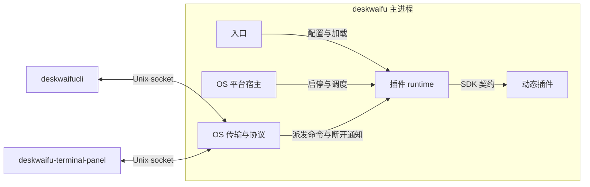

# 程序架构

## 进程与组件



| 组件 | 职责 |
| --- | --- |
| [常驻宿主](<../apps/deskwaifu/src/main.rs>) | 建立 Tokio `current_thread` 上下文，装配 runtime、加载配置与插件，调用 `deskwaifu_os::run(runtime)`。启动命令不接受参数。 |
| [命令行客户端](<../apps/deskwaifucli/src/main.rs>) | 向运行中的宿主发命令并输出结果。无参数、`--help` 和 `-h` 显示本地用法。`help` 子命令通过 IPC 获取宿主的命令列表。 |
| [控制面板](<../apps/terminal-panel/src/main.rs>) | 独立 GPUI Kit 进程，通过 IPC 显示插件注册的标签页、查询视图和执行操作。 |
| [OS 平台宿主](<../crates/os/src/host.rs>) | 拥有 socket 与 runtime，负责 IPC、异步调度、退出信号和系统服务。协议层只校验信封并交付参数数组。 |
| [插件 runtime](<../crates/runtime/src/lib.rs>) | 加载动态库，维护生命周期、命令表、配置、面板注册、逻辑时钟、消息队列和本地异步任务。 |
| [插件 SDK](<../crates/sdk/src/lib.rs>) | 定义 `Plugin`、`Context`、消息、面板描述和系统服务等接口。 |
| 动态插件 | `terminal` 负责 Live2D 模型展示、交互和配置。`voice_input` 负责定时录音、识别和复制。`test-plugin` 提供回显参数的 `test` 命令。 |

入口依赖 OS 和 runtime，OS 依赖 runtime 与 SDK，runtime 依赖 SDK。CLI 借助 OS 的客户端函数将命令发给主程序。面板实现自己的 IPC 客户端。宿主与 runtime 通过动态库入口获取插件实例，无须静态链接业务插件。

## IPC 与命令

Unix stream socket 固定为 `/tmp/deskwaifu.socket`，权限为 `0600`。已有路径会导致绑定失败。正常退出仅清理宿主所绑定的 socket，删除前检查设备号和 inode。 [监听及清理](<../crates/os/src/lib.rs>)

CLI 和面板都使用 `source: "cli"`。每个请求和响应都是以 LF 分帧的 UTF-8 JSON，支持分次读写和持久连接。响应按请求顺序返回。CLI 每次调用使用独立连接。 [协议与资源限制](<../crates/os/src/lib.rs#L25>)

```json
{"source":"cli","payload":["test","你好 world","","001"]}
{"status":"ok","output":"命令输出"}
{"status":"error","error":"错误描述"}
```

- `payload` 是字符串数组，第一项为命令名。其余参数原样传给插件，保留空字符串与空白。不接受未知信封字段。
- 每条请求或响应的 JSON 上限为 **64 KiB**，不含 LF。请求超限时返回错误并关闭连接，响应超限时返回一条错误响应。非法信封、非法 UTF-8 和 EOF 前未以 LF 结尾的请求均不派发。
- 同时维护最多 **32 个连接**，连接读写活动超时为 **10 秒**。每个连接每轮最多读取 4 KiB、派发一个请求、写入 4 KiB。该超时只约束连接活动。
- 宿主把连接 ID 和参数交给 `Runtime::dispatch_connection_command`。业务命令由其所属实例的 `Plugin::on_command` 执行，插件可通过 `Context::connection_id()` 获取连接标识。连接关闭时，`Plugin::on_disconnect` 可用于释放关联资源。CLI 打印成功输出并退出 0，命令或传输失败时非零退出。 [宿主派发](<../crates/os/src/host.rs#L50>) · [SDK 回调](<../crates/sdk/src/lib.rs#L229>)

## 插件与共享接口

- **加载。** runtime 从实际可执行文件旁的 `plugins/` 按文件名排序加载 `.so`。SDK 的 `export_plugin!` 导出 Rust ABI 入口 `deskwaifu_plugin_create() -> Box<dyn Plugin>`。宿主与插件须使用同一工具链、同版源码和依赖联合构建。插件共享宿主进程权限，部署目录仅放置可信插件。任一动态库加载失败时宿主停止启动。更新插件需要重启宿主。 [动态加载器](<../crates/runtime/src/dynamic.rs>)
- **注册。** `Plugin::plugin_id` 提供唯一的稳定英文标识。`initialize` 中可登记命令名、帮助、面板标签页和类型化订阅。`help` 与 `panel-tabs` 是宿主保留命令。面板标签页按 `order`、插件 ID、标签页 ID 排序，查询及按钮命令必须属于该插件。 [注册与面板查询](<../crates/runtime/src/lib.rs#L424>)
- **配置。** 共享文件位于 `$XDG_CONFIG_HOME/deskwaifu/config.jsonc`，无绝对 XDG 路径时使用绝对 `$HOME` 下的 `.config/deskwaifu/config.jsonc`。已有文件须为 `0600` 的普通文件。顶层键使用插件 ID，`Context::config` 读取插件自身节点的快照，`Context::replace_config` 原子替换自身节点并保留节点外的文本和注释。 [配置存储](<../crates/runtime/src/config.rs#L17>)
- **本地任务与系统服务。** `Context::spawn_local` 提交由宿主线程轮询的 Future，可持有 `Context::os()` 返回的共享句柄。Linux 系统服务提供 PipeWire 默认麦克风采集和 Wayland UTF-8 剪贴板读写。录音块为 16 kHz 单声道 S16LE。剪贴板单次上限为 1 MiB。 [系统服务接口](<../crates/sdk/src/os.rs#L62>) · [平台实现](<../crates/os/src/services.rs>)
- **类型化消息。** `subscribe::<T>` 按 `TypeId` 登记，`publish(T)` 将带发送者 ID 的共享负载 `Arc<dyn Any + Send + Sync>` 放入有界 FIFO。主程序配置容量为 1024 条广播，不限制负载字节数。`advance` 每轮最多派发容量数量的广播，接收者按注册顺序执行。外部命令直接派发到实例。 [发布订阅](<../crates/runtime/src/lib.rs#L148>) · [广播调度](<../crates/runtime/src/lib.rs#L554>)

## 启停与调度

1. **启动**时，入口加载配置与动态库。平台宿主绑定 socket，注册 `SIGINT` / `SIGTERM`，注入系统服务，然后调用 `Runtime::start`。runtime 依次尝试初始化各插件。初始化失败时撤销该插件的命令、标签页和订阅，调用 `stop` 清理并跳过。统一激活通信后，按顺序启动初始化成功的插件。启动完成后输出监听地址。
2. **运行**时，宿主按单调时钟推进 runtime，等待退出信号、本地任务、IPC 就绪事件或下一个调度期限。周期任务由 `tick_interval` 指定非零周期，首次回调在一个周期后触发，繁忙时跳过错过的 tick。回调与本地任务在主线程上串行执行，阻塞会延迟其他客户端、调度和退出。插件可为阻塞操作管理自己的工作线程。
3. **退出**时，宿主通知连接断开，runtime 停用通信、清空排队消息、丢弃未完成的本地任务并按逆序停止插件。启动、tick 或内部消息回调失败触发停止。单个插件 `stop` 返回错误时仍继续清理。插件须在 `stop` 中回收自有线程。runtime 释放插件实例和依赖库代码的值后卸载动态库。平台宿主关闭系统服务并清理监听资源。

[启动和退出](<../crates/os/src/host.rs>) · [调度和生命周期](<../crates/runtime/src/lib.rs>)

## 部署与验证

使用 Cargo 联合构建 workspace。完整构建的图形依赖与 SDK 路径见 Cubism 构建说明。开发部署脚本将已有动态库复制到对应 profile 的 `plugins/`。构建与部署 Release 产物时分别传入 `--release`。Arch 安装包将宿主和插件放在 `/usr/lib/deskwaifu/`，CLI 与面板安装于 `/usr/bin/`。 [Cubism 构建说明](<../crates/cubism-bridge/README.md>) · [部署辅助脚本](<../scripts/deploy-plugins.sh>) · [Arch 安装模板](<../packaging/release/PKGBUILD.in>)

```sh
cargo build --workspace --locked
./scripts/deploy-plugins.sh
./target/debug/deskwaifu
```

在另一终端查询宿主命令或验证参数传递。

```sh
./target/debug/deskwaifucli help
./target/debug/deskwaifucli test '你好 world' '' '001'
```

主要回归测试涵盖独立进程通信、连接与分帧限制、插件生命周期及动态加载。 [宿主冒烟](<../apps/deskwaifu/tests/smoke.rs>) · [IPC](<../crates/os/tests/ipc.rs>) · [动态库](<../crates/runtime/tests/dynamic.rs>) · [runtime](<../crates/runtime/tests/runtime.rs>)
