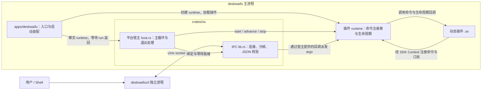

# 程序架构

> 本文描述 Rust 重写版本的现有架构，不描述 `legacy_cpp/` 中归档的 C++ 实现，也不将规划中的功能视为已经实现。

## 一、总体设计

程序采用 **独立主程序 + 独立命令行客户端 + 进程内动态插件** 的结构。

- **`deskwaifu`** 是常驻主程序。其入口 `apps/deskwaifu` 只负责把程序拉起来：建立主线程异步上下文、检查参数、创建 runtime、加载插件，再将控制权交给 `deskwaifu_os::run(runtime)`。socket 监听、主循环和退出处理不在入口中实现。目前不接受任何启动参数，包括 `--help`。
- **`deskwaifucli`** 是独立命令行程序，负责将子命令及参数发送给主程序，再输出执行结果。它不启动主程序、不加载插件，也不在连接失败时回退到本地执行。
- **插件** 是主程序加载的 `.so` 动态库，不是独立进程。插件通过 SDK 注册命令和周期任务，由 runtime 在宿主线程中统一调用。
- **OS 组件** 是链接进程序的普通 Rust crate，不是 OS 插件。它既提供 socket 与 JSON 协议处理，也承担平台宿主职责：绑定监听、安装退出信号、驱动主循环、调用 runtime 启停与命令派发。传输层不解释业务子命令，业务名称查找与参数执行仍由 runtime 和插件负责。



当前外部控制链路是 **socket 请求 → 命令派发 → 插件回调 → socket 响应**，不经过插件消息广播总线。

## 二、模块与依赖边界

### 2.1 各模块的主要功能

| 模块 | 代码位置 | 主要功能与边界 |
| --- | --- | --- |
| 主程序入口 | `apps/deskwaifu/src/main.rs` | 建立 Tokio `current_thread` 上下文，拒绝启动参数，创建容量为 1024 的 runtime，定位可信插件目录并请求加载，最后调用 OS 宿主；不监听 socket、不驱动调度、不处理退出信号 |
| 命令行客户端 | `apps/deskwaifucli/src/main.rs` | 读取 Shell 参数，显示本地用法或调用 OS 的 `call`，输出成功结果或错误；不加载插件、不启动宿主 |
| OS 平台宿主 | `crates/os/src/host.rs` | `run` 接管 runtime 所有权，绑定 socket、安装信号监听、启动插件；`run_loop` 按插件期限驱动时钟、等待 IPC 就绪；退出时调用 `stop` 并通过资源释放清理 socket |
| OS 传输与协议 | `crates/os/src/lib.rs`、`async_server.rs` | `Server` / `Client` 管理监听与连接、非阻塞读写、分帧、超时和资源限制；`Request` / `Response` 定义信封；`call` 提供同步客户端调用；不查找业务命令 |
| 插件运行时 | `crates/runtime/src/lib.rs`、`dynamic.rs` | 动态库发现与加载、插件实例及库句柄管理、生命周期状态机、命令表与内建 help、逻辑时钟与 tick、有界消息总线；不处理 socket 和 Unix 信号 |
| 插件 SDK | `crates/sdk/src/lib.rs` | 定义 `Plugin`、`Host`、`Context`、命令与消息类型、动态入口及导出宏；只提供共享契约，不监听、不调度，也不持有全局运行时 |
| 测试插件 | `plugins/test-plugin/` | 依赖 SDK 实现插件，注册 `test` 命令并返回收到的参数，用于验证动态加载和通信链路；不依赖平台传输实现 |

### 2.2 编译依赖关系

生产代码的主要依赖方向：

```text
deskwaifu ──────→ os ──────→ runtime ──────→ sdk
    │             ↑
    ├─→ runtime   └──────── deskwaifucli
    └─→ Tokio（入口宏与单线程执行器）

os ────────────→ Tokio（定时器、信号）、serde / serde_json（协议）
runtime ───────→ libloading（动态库）
动态插件 ──────→ sdk
```

这里的箭头表示源码中的生产依赖，不表示独立进程间的通信，也不等同于运行时调用方向：

- `deskwaifu` 直接依赖 runtime 是为了创建实例与加载插件，依赖 OS 是为了把该实例交给平台宿主运行。
- **OS 现在生产依赖 runtime**，因为平台宿主需要启停插件、推进时钟和派发命令；OS 不直接生产依赖 SDK，但会通过 runtime 间接依赖 SDK。不能再将整个 OS crate 描述为“不依赖 runtime/SDK”。
- OS 内部仍区分宿主与传输：`host.rs` 组合 runtime 与 `Server`，`lib.rs` 的协议处理通过传入的回调交付 `argv`，不直接操作插件。
- `deskwaifucli → os` 表示复用协议与客户端函数，不代表 CLI 会调用 `os::run`；CLI 运行时不创建插件 runtime，但目前会在 crate 依赖层面间接依赖 runtime。
- 插件只生产依赖 SDK；主程序和 runtime 不静态依赖具体业务插件。runtime 通过动态库入口获得 `Box<dyn Plugin>`，再按 SDK 契约调用它。测试代码对具体测试插件的依赖不属于上述生产依赖。

### 2.3 控制关系与所有权

**入口装配，OS 驱动，runtime 管理插件，插件实现业务。**

1. **启动控制**：入口创建 `Runtime` 并请求动态加载；随后调用 `deskwaifu_os::run(runtime).await`，将 runtime 的所有权移交 OS。入口不再保留另一个主循环。
2. **宿主控制**：OS 创建并持有 `Server`，安装退出信号，调用 `Runtime::start`，随后推进逻辑时钟，并等待 socket 就绪、插件下一次到期时间或退出信号。没有待派发消息和周期任务时，不设置插件定时器，也不定期检查 socket。
3. **命令控制**：OS 传输层收到有效请求后，调用宿主提供的 `|argv| runtime.dispatch_command(argv)`；runtime 查找注册表并调用插件函数，结果沿原链路返回。CLI 只发出请求，不直接持有或调用插件实例。
4. **插件控制**：runtime 持有插件实例、命令表、消息队列和动态库句柄，决定生命周期回调、tick 和消息派发顺序。插件通过借用的 `Context` 注册命令、订阅与发布消息，不反过来接管平台主循环。
5. **退出控制**：OS 收到退出信号或主循环错误后结束驱动并调用 `stop`；runtime 负责使总线失效、丢弃消息、逆序停止插件；OS 释放监听资源，runtime 析构负责最终释放实例和动态库。

SDK 是这些调用共同遵守的接口层，不是运行中的调度中心。平台宿主也不是后台线程或额外进程：上述控制都在入口建立的主线程异步上下文内执行。

## 三、两个程序的使用边界

主程序单独运行：

```sh
deskwaifu
```

另一个终端通过独立 CLI 调用命令：

```sh
deskwaifucli test
deskwaifucli test '你好 world' '' '001'
deskwaifucli help
```

`deskwaifucli` 无参数、`--help` 或 `-h` 显示客户端本地用法；`deskwaifucli help` 则经 IPC 获取主程序当前注册的命令帮助。这两种帮助的来源不同。

socket 地址固定为 **`/tmp/deskwaifu.socket`**。没有 socket 路径配置，也不依赖 `XDG_RUNTIME_DIR`。同一系统同时只能有一个实例绑定这个地址；现有路径不会被自动覆盖，包括崩溃遗留的 socket。

## 四、IPC 协议与命令链路

### 4.1 传输与信封

传输使用 Unix stream socket。每条请求、响应都是 **UTF-8 JSON，以 LF（`\n`）结束**，支持拆包、粘包及同连接的多次请求。

例如执行：

```sh
deskwaifucli test '你好 world' '' '001'
```

发送的请求为以下 JSON 加末尾 LF：

```json
{"source":"cli","payload":["test","你好 world","","001"]}
```

- `source` 当前只支持 `cli`。GUI 来源没有实现，收到后不会派发业务命令。
- `payload` 必须是字符串数组，不包含可执行文件名。首项为子命令，后续项为命令参数。
- OS 组件校验 UTF-8、JSON 结构和字段，不继续解释业务参数。未知字段被拒绝。
- 参数不 trim、不按空格重新拆分、不执行 shell，也不继续解析参数字符串中的 JSON。JSON 转义会正常还原为字符串值。

成功与失败响应分别为：

```json
{"status":"ok","output":"命令输出"}
```

```json
{"status":"error","error":"错误描述"}
```

同连接响应按请求顺序返回，没有请求 ID。CLI 每次命令调用新建一个连接，发送一条请求并等待一条响应；成功打印输出并退出 0，命令或传输错误以非 0 退出。

### 4.2 派发过程

1. CLI 获取 Shell 已处理好的参数数组并序列化。
2. OS 组件接收字节，累计到完整 LF 帧后解析信封。
3. `crates/os/src/host.rs` 提供给 `Server::poll_ready` 的处理回调调用 `Runtime::dispatch_command`，入口 `apps/deskwaifu` 不参与逐条命令派发。
4. runtime 以第一个参数查询命令注册表，将剩余的 `&[String]` 交给回调。
5. 回调返回 `Result<String, String>`，OS 组件编码为成功或失败响应。
6. CLI 读取响应并输出结果。

普通的未知命令、命令回调返回错误或非法完整请求，不会使整个 runtime 停止。协议错误不等于插件生命周期故障。

### 4.3 资源限制

- 每条请求和响应最大 **64 KiB**，按编码后的 JSON 字节计算，不含末尾 LF。
- 最多维护 **32 个已接收的客户端连接**；达到上限后暂不继续 accept，由监听队列提供背压。
- 连接读写活动超时为 **10 秒**；这不是命令执行超时，也没有命令取消机制。
- 每个连接每轮最多读取 4 KiB、执行一条请求、写入 4 KiB。响应没有写完时，不继续执行该连接的下一条请求。
- 超长请求返回错误并关闭连接；超长响应改为错误响应，而不是截断业务输出。
- EOF 前没有 LF 的半帧不执行；非法 JSON、UTF-8 或信封不进入命令回调。
- socket 权限设为 `0600`。退出清理时核对设备号和 inode，避免误删已被替换的路径。

## 五、动态插件机制

### 5.1 发现与加载

主程序启动时，以 `std::env::current_exe()` 定位实际可执行文件，从其旁边的 `plugins/` 目录加载 `.so`，按路径排序，不依赖启动时的工作目录。

```text
target/debug/
├── deskwaifu
├── deskwaifucli
└── plugins/
    └── libdeskwaifu_test_plugin.so
```

目录必须存在；空目录可以启动，但不会提供测试插件的 `test` 命令。缺少入口、无效动态库、插件名称重复等情况会报错。目录批量加载失败后 runtime 会失效，不允许继续启动残缺的插件集合。

### 5.2 共享接口

SDK 的 `export_plugin!` 宏导出固定入口：

```rust
fn deskwaifu_plugin_create() -> Box<dyn Plugin>
```

runtime 通过 `libloading` 查找 `deskwaifu_plugin_create` 并创建实例。测试插件同时生成 `rlib` 和 `cdylib`：前者用于 Rust 测试依赖，后者用于实际动态部署。

这是快速迭代期的 **内部 Rust 接口**，不是稳定 C ABI，没有版本协商或兼容性检测。主程序与插件必须使用相同工具链及同版代码、依赖联合构建。不兼容动态库可能造成未定义行为，不能视为“必然会被校验拒绝”。

只允许加载可信插件。插件和宿主共享地址空间及进程权限，不提供崩溃隔离、权限沙箱或第三方 ABI 兼容保障。

### 5.3 命令注册

插件在 `initialize` 中使用 `Context::register_command` 提供：

- 子命令名；
- 帮助字符串数组；
- `fn(&[String]) -> Result<String, String>` 回调。

命令名必须非空且不含空白；重复命令和内建保留命令 `help` 被拒绝。注册表使用 `BTreeMap`，内建 `help` 按命令名排序显示，并根据最长命令名对齐多行帮助。

当前回调是函数指针，不是可捕获插件实例的闭包，也不是异步函数。需要状态的业务不能假设命令接口自动提供了对插件实例的可变借用。

### 5.4 生命周期与卸载

```text
Created
  → 加载动态库、创建实例
  → 按顺序 initialize，登记命令、订阅和 tick 周期
  → 尝试初始化所有插件后激活通信
  → 按顺序启动初始化成功的插件
  → Running：执行命令、tick 与内部消息派发
  → stop：失效总线、清空队列、逆序停止已初始化的插件
  → Stopped：不可重启
  → Runtime 销毁：释放实例、队列和命令注册表，最后卸载动态库
```

初始化失败时，runtime 记录错误，撤销该插件的命令与订阅，调用 `stop()` 清理部分初始化的资源，然后跳过该插件。启动、tick 或内部消息处理失败会触发 runtime 停止。`stop()` 可重复调用，单个插件停止失败后仍会清理其余插件。插件 panic 会继续传播。

**停止插件不等于立即卸载库。** 动态库句柄在 runtime 中保留到实例、消息负载和命令回调全部释放之后。插件必须在停止时等待自己的工作线程退出，不得让依赖动态库代码的对象或回调存活到 runtime 销毁之后。

当前只实现启动加载、退出卸载，不支持运行时热加载、热卸载或热更新。

## 六、执行与线程模型

### 6.1 Tokio 驱动的单线程主循环

`apps/deskwaifu/src/main.rs` 使用 `#[tokio::main(flavor = "current_thread")]` 建立主线程异步上下文，随后等待 `deskwaifu_os::run(runtime)`。实际主循环位于 `crates/os/src/host.rs`，不是入口模块。Tokio 负责定时等待和 Unix 信号监听，插件 runtime 本身不依赖 Tokio。

主循环先根据单调时钟的真实经过时间执行 `runtime.advance(delta)`，然后通过 `tokio::select!` 等待：

- `SIGINT` / `SIGTERM` 退出信号；
- socket 监听、连接读写就绪或客户端活动超时；
- `Runtime::next_wakeup()` 提供的下一次插件调度期限。

信号分支优先检查。没有周期任务或待派发消息时，插件定时分支永久挂起；没有连接事件时，socket 分支挂起等待操作系统通知。**不再每 5 ms 唤醒检查 socket**。存在周期插件或已连接客户端的超时期限时，才为这些实际需要设置定时等待。插件繁忙时仍跳过错过的 tick，不追赶。

所有插件生命周期、命令回调、tick 和内部消息回调仍在同一主线程串行执行，`Plugin` 没有被要求实现 `Send`，也没有把命令分发到多个并发任务。

**socket 采用就绪事件驱动：** `crates/os` 使用 Tokio `AsyncFd` 将标准库非阻塞 `UnixListener` / `UnixStream` 注册到 I/O 事件循环，由 `Server::poll_ready` 等待连接、可读或可写事件，随后进行一轮有界处理。等待可被插件定时器或退出信号取消，连接、半帧和待写响应保存在 Server 中，不因取消而丢失。没有“每连接一个异步任务 + channel 请求队列”，所有命令仍由同一宿主线程串行执行。同步 `Server::poll` 保留供原有调用者与测试使用，但生产宿主不再通过固定定时器调用它。CLI 仍使用同步 I/O，并设置读写超时。

### 6.2 调度边界与阻塞影响

平台宿主不创建后台任务，也不把每个客户端或插件交给线程池。`os::run` 在调用者的异步上下文中执行；主线程保证来自入口使用 `current_thread` 并直接 `.await`，而不是 OS 自行创建了一条专用线程。

**回调阻塞会阻塞整个宿主调度**，包括其他客户端、插件 tick 和退出处理。Tokio 不会自动把同步插件回调转成非阻塞操作，也不提供命令响应延迟或实时调度保证。

### 6.3 周期任务

插件通过 `tick_interval()` 提供可选的非零周期。runtime 使用可手动推进的逻辑时钟，首次 tick 在一个周期后触发；延误时跳过错过的 tick，不追赶。测试可以直接调用 `advance(Duration)`，不依赖真实等待。

runtime 还保留同步的 `run_for(Duration)` 驱动接口，但当前由 OS 平台宿主的异步主循环调用 `advance`，不调用 `run_for`。

## 七、保留的内部消息总线

SDK/runtime 仍保留类型化发布订阅接口；“CLI 命令不使用广播”不等于这部分代码已经删除。

- 通过 `TypeId` 订阅，通过 `Arc<dyn Any + Send + Sync>` 共享消息负载，消息附带发送者 `PluginId`。
- 广播进入有界 FIFO，容量限制广播条数，不限制负载字节数；当前主程序创建 runtime 时容量为 1024。
- 发布仅代表入队，不递归调用接收方；每次 `advance` 有派发数量上限，避免连续自发消息占满一轮调度。
- `Context` 不能传给工作线程直接发布消息。

这是进程内部的 Rust 契约，不是 socket 协议，也不是跨独立构建插件的稳定数据格式。测试插件目前只注册命令，不再定时发送测试消息。

## 八、启动、退出与部署

启动与控制权移交顺序为：

```text
apps/deskwaifu
  建立 Tokio current_thread 上下文
  → 拒绝启动参数
  → 创建 Runtime（消息容量 1024）
  → 定位可执行文件旁的 plugins/，请求 runtime 加载动态插件
  → deskwaifu_os::run(runtime).await（移交所有权与控制权）
      绑定固定 socket
      → 安装 SIGINT / SIGTERM 监听
      → runtime.start()（initialize → start）
      → 输出 Listening 日志
      → OS 主循环（advance → 等待 socket / 插件期限 / 退出信号）
      → 退出信号或循环错误
      → runtime.stop()
      → 释放 Server，清理自身 socket；释放 Runtime，最终卸载动态库
  → 入口返回，进程结束
```

插件加载发生在 socket 绑定之前；加载失败不会进入 OS 监听阶段。绑定失败或信号监听安装失败不会启动插件；单个插件初始化失败后，runtime 记录错误并跳过该插件。启动回调失败时，runtime 停止已初始化的插件，OS 通过 `Drop` 释放监听资源。

收到 `SIGINT` 或 `SIGTERM` 后先退出循环，再显式停止插件。正常函数退出时，局部 `Server` 先释放并清理自身 socket，传入的 runtime 随后销毁；停止插件与最终卸载动态库是两个阶段。`Drop` 提供兜底清理，但 `SIGKILL`、进程崩溃等情况不保证执行清理。socket 绑定成功并不代表插件已经启动完成；程序没有单独的就绪握手协议。

开发时运行：

```sh
./scripts/build.sh
# 一个终端启动主程序
./target/debug/deskwaifu
```

```sh
# 另一个终端发送命令
./target/debug/deskwaifucli test '你好 world' '' '001'
```

构建脚本联合编译 workspace，并把插件复制到对应 profile 的 `plugins/`；release 使用 `./scripts/build.sh --release`。仅运行 `cargo run -p deskwaifu` 不会自动构建和部署插件。

Arch 安装布局为：

```text
/usr/bin/deskwaifu → ../lib/deskwaifu/deskwaifu
/usr/bin/deskwaifucli
/usr/lib/deskwaifu/deskwaifu
/usr/lib/deskwaifu/plugins/libdeskwaifu_test_plugin.so
```

## 九、现阶段边界与验证入口

当前架构尚未实现 GUI 来源业务、完整桌宠渲染、插件热更新、稳定动态库 ABI、命令执行取消、异步插件回调或跨进程插件隔离。未来扩展这些能力时，应继续保持“传输不解释业务、客户端不持有插件、宿主统一管理生命周期”的边界。

主要回归验证入口：

- `apps/deskwaifu/tests/smoke.rs`：双程序通信、固定 socket、主程序参数拒绝、动态插件部署与退出清理。
- `apps/deskwaifucli/tests/cli.rs`：不启动主程序即可显示 CLI 本地帮助。
- `crates/os/src/host/tests.rs`：OS 异步主循环、非 `Send` 插件仍在调用线程执行、定时等待与 tick 出错后的清理。
- `crates/os/src/async_server/tests.rs`：事件驱动监听、取消等待后的状态保留、持久连接、活动超时与连接上限恢复、大帧及半关闭连接。
- `crates/os/tests/ipc.rs`：分帧、参数保真、输入校验、大小限制、背压与异常连接隔离。
- `crates/runtime/tests/dynamic.rs`：真实 `.so` 加载、命令冲突、失败清理与实例销毁先于动态库卸载。
- `crates/runtime/tests/runtime.rs`：生命周期、内部消息队列及周期任务行为。

本文是代码现状说明；新增或调整程序入口、线程模型、IPC 协议及插件生命周期时，应同步更新对应章节。
