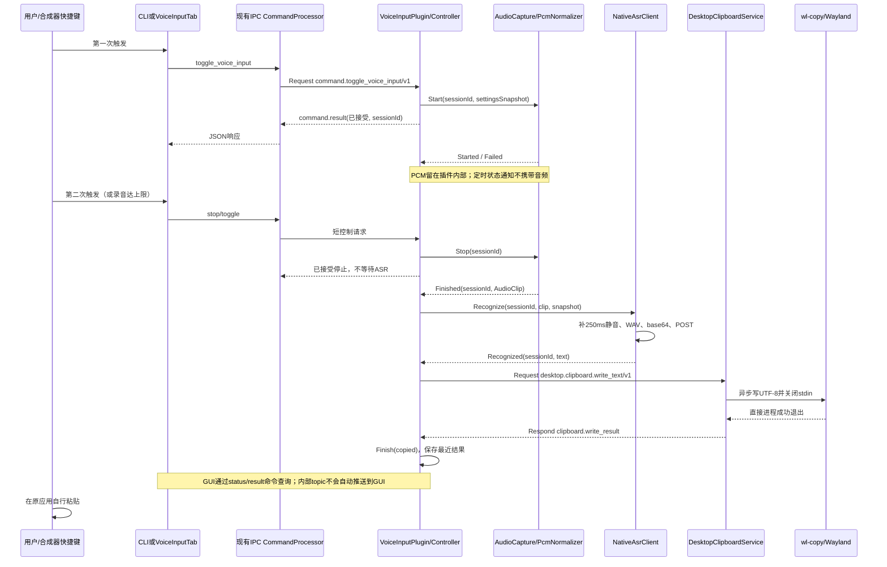

# 桌宠语音输入实施计划

## Steps

- [x] 固化消息契约、状态机和平台边界，并验证无焦点 Wayland 剪贴板链路。
- [x] 为 desktop 插件增加独立的文本剪贴板写入能力及契约测试。
- [x] 实现 voice_input 插件的音频采集、格式归一化和原生 HTTP ASR。
- [x] 完成录音、识别、取消及剪贴板写入编排，接通 IPC 与控制面板。
- [x] 完善配置、隐私保护、构建打包与用户使用文档。
- [x] 完成离线自动化、真实 Wayland 音频链路和可选云端验收。

## 1. 目标与验收标准

用户已批准开始实施：控制面板必须可修改 ASR 端点和 API_KEY，并迁移原项目控制状态机。以下为实施依据，具体签名按既有代码风格调整；各步骤完成并验证后更新勾选。

目标：不再运行独立 VoiceInput 守护进程，由桌宠提供“触发录音 → 再次触发停止 → 识别 → 写入系统剪贴板 → 用户粘贴”的语音输入工作流。

验收标准：

1. 桌宠增加独立 `voice_input` 插件，负责麦克风采集、HTTP 识别及语音输入编排；现有 `speech` 仍只负责 TTS，不混用配置或业务。
2. desktop 独立提供写文本剪贴板能力，其他插件不依赖其私有头文件；关闭语音输入插件后，该能力仍可单独使用。
3. 控制面板和 `deskwaifu-ctl` 都能开始、停止、取消录音并查询状态。合成器快捷键调用 CLI，实现其他应用持有焦点时的语音输入。
4. 录音默认最长 60 秒，到时自动停止并识别；同一时刻最多一段录音/一次识别。识别中再次 toggle 返回 busy，不隐式取消或排队。
5. 识别成功且剪贴板后端确认成功后，才提示“已复制”；采集、识别、剪贴板任一步失败均可查询原因并重新开始。
6. 取消、超时、设备断开、插件停止和旧会话迟到回调均有明确语义；取消后的识别结果不得发起新的剪贴板写入。
7. 普通自动测试不访问真实麦克风、剪贴板或云端，不需要密钥；真实桌面和 live 测试单独启用。

范围边界：

- 与参考项目一致，首版是剪贴板型语音输入工具，不是 Fcitx/IBus 输入法引擎；不注入 Ctrl+V，不自动向焦点窗口键入。
- 首版为整段录音后的单次 HTTP ASR，不增加流式识别、VAD、唤醒词、降噪、LLM 润色或多 ASR 服务商框架。
- 全局快捷键由 Sway/Hyprland 等合成器绑定 CLI；不新增跨桌面全局快捷键管理器，不抢占键盘焦点。
- 保留设备选择、状态/时长反馈及失败提示；不迁移 FIFO、多实例守护进程和默认全量录音日志。

## 2. VoiceInput 项目分析

分析来源：`ssh://git@git.kals.top:2222/kals/VoiceInput.git`。

固定分析版本：`a7e533f6fcff465e4e45d8c40d65c0936dfd6838`。本次阅读了源码与测试，未运行其构建、硬件或 live 测试，不将现有测试用例等同于本次验证通过。

### 2.1 实际工作流程

参考项目名为 `vollminputd`，使用 Rust、CPAL/PipeWire、reqwest/tokio、notify-rust 和 `wl-copy`，另有 Qt 控制面板。

- `src/main.rs`：FIFO/Unix socket 控制、主循环、异步 ASR 调用。
- `src/state.rs`：`Idle → Recording → Transcribing → Idle`；识别中禁止 toggle。
- `src/app.rs`：启动/停止采集、录音超时、通知及复制编排。音频和剪贴板操作部分直接执行，并非完全通过副作用枚举执行，不宜机械移植枚举名称。
- `src/audio.rs`：选择设备、采集 PCM、构造 WAV；实际固定 16 kHz、单声道、16-bit，与部分环境配置项无关。
- `src/asr/native.rs`：追加 250 ms 尾静音，构造 WAV/base64，调用原生 HTTP 服务并解析文本。
- `src/clipboard.rs`：向 `wl-copy` 的 stdin 写原始 UTF-8 文本、关闭 stdin、等待直接子进程退出。
- `src/control.rs`：Unix socket 的 toggle/get_status，请求立即返回控制结果，不等待整段识别完成。
- `src/notifier/mod.rs`：开始、每秒录音时长、识别中及结果的桌面通知。
- `src/asr/log.rs`：默认把上传 WAV 和文本保存到 `/var/log/vollminputd`。

其快捷键本质上是合成器执行外部命令，不是程序自身注册全局键。写剪贴板后仍由用户手动粘贴。

### 2.2 必须兼容的 ASR 协议

参考默认完整端点为：

`https://llm-y3exskfcgxgxzn23.cn-beijing.maas.aliyuncs.com/api/v1/services/aigc/multimodal-generation/generation`

模型为 `qwen-audio-3.0-asr-flash`。该地址是参考项目使用的专用服务地址，不宣称它是所有 DashScope 账户均可用的公共端点；提供可编辑配置，上线前由实际账户验证。

请求为单次 POST，不是 OpenAI transcription、multipart 或 WebSocket：

```http
Authorization: Bearer <api-key>
Content-Type: application/json
X-DashScope-SSE: disable
```

```json
{
  "model": "qwen-audio-3.0-asr-flash",
  "input": {
    "messages": [{
      "role": "user",
      "content": [{
        "type": "input_audio",
        "input_audio": {"data": "data:audio/wav;base64,<WAV>"}
      }]
    }]
  },
  "parameters": {"format": "wav", "sample_rate": "16000"}
}
```

注意 `sample_rate` 是字符串。WAV 使用 PCM16 LE / 16000 Hz / mono，44 字节标准头，封装前额外追加 8000 字节零值，即 250 ms 静音。

响应仅接受 HTTP 2xx；优先取顶层字符串 `text`，否则取 `output.text` 字符串。顶层空字符串仍优先，不回退。参考程序空字符串报“未检测到语音”，非空文本不 trim、不去标点。本实现增加“仅空白也按无语音处理”的明确改进，但正常识别文本写入时保持原始空格、换行及 Unicode。

参考连接超时 15 秒、总请求超时 120 秒；Qt 迁移必须有总时限，不能只用网络 inactivity timeout 冒充总时限。

### 2.3 保留与改进

保留：设备选择、toggle 工作流、最大录音时长、精确 HTTP 格式、尾静音、文本原样复制、可查询状态。

不照搬以下问题：

- 参考采集硬编码格式，未使用采样率/声道配置；设备不支持时不能假装音频已是目标格式。
- 录音开始后才清缓冲，设备错误只记日志，停止失败时计时状态清理不统一。
- 主循环同步等待 `wl-copy`，可能阻塞控制请求。
- 没有 cancel/session generation，无法可靠隔离取消后迟到的异步结果。
- FIFO 权限为 0666；桌宠直接复用现有 IPC，不再开放新入口。
- 默认保存原音频和识别文字，并把全文放入日志/桌面通知；首版不落盘，不在普通日志/系统通知暴露全文。

用户确认两个项目代码均为本人编写，本轮不开展许可证核查。实现将迁移原项目纯控制状态机及其合法/非法转换用例，而不是仅模仿界面上的 toggle。

### 2.4 实施期间用户指定的兼容模式端点

用户追加指定默认端点为 `https://llm-y3exskfcgxgxzn23.cn-beijing.maas.aliyuncs.com/compatible-mode/v1`，模型仍为该账户可用的 `qwen-audio-3.0-asr-flash`。新增一个小型协议分支：兼容模型以 `/v1` 结尾的 base 自动追加 `/chat/completions`，完整路径不重复追加；发送顶层 `messages`、`stream:false`，解析 `choices[0].message.content`，不再给兼容请求发送原生 `input/parameters`。真实验证发现默认 `qwen-audio-3.0-asr-flash` 不支持 chat/completions（HTTP 400），但同域原生 ASR 请求成功。因此该明确的原生专用模型在填写兼容 base 时，发送前解析为同域 `/api/v1/services/aigc/multimodal-generation/generation`，不修改host、不失败重试。保留原项目完整原生端点兼容，PCM/WAV 和状态机迁移不变，不增加 provider 框架。

用户授权读取 `/tmp/bailian` 的内容进行 live 验证；凭据不写仓库或日志。CI 使用 `secrets.BAILIAN_API_KEY` 和 `vars.BAILIAN_OPENAI_ENDPOINT`，云端入口只上传仓库中合成短句，验证已知语义，不使用真实麦克风或私人录音。普通门禁与 live 凭据分离。

## 3. 桌宠现有架构与接入约束

已核对的接入点：

- `sdk/plugin/PluginContext.hpp`：`CreateEndpoint()`、`ConfigDirectory()`；端点由 context 管理。
- `sdk/event/EventEndpoint.hpp`：`Provide/Request/Respond/Notify/Subscribe/Cancel`，通过 requestId 关联请求；总线超时默认 30 秒。
- `plugins/ipc/private/processor/command/CommandProcessor.hpp`：把外部 JSON 自动路由至 `command.<command>/v1`，正文为 `command.invoke`，携带 `json/connection`；响应为 `command.result`，携带 `json`。
- `plugins/speech/SpeechPlugin.cpp`、`SpeechSettings.hpp` 及 `gui/`：后端能力、脱敏配置和 GUI 插件范例。
- `plugins/desktop/DesktopPlugin.cpp`：现有模型/交互命令桥接；新增剪贴板服务不经过模型渲染队列。
- `sdk/plugin/GuiHostServices.hpp`：GUI 在独立控制进程中，通过 `sendCommand()` 和 `responseReceived` 交互；没有通用领域 topic 推送接口。
- `sdk/contracts/ConfigStore.hpp`：带快照冲突检测的配置存储，可强制文件 0600。
- `deskwaifu-ctl`：已有通用命令发送，不限制命令名称；新增数字参数仍须更新类型集合。

约束：

1. 只在 SDK contracts 放共享 DTO/消息名称，不让 voice_input include desktop 私有实现，不更改插件 ABI。
2. 总线只传控制、状态、结果及一次性音频请求；连续 PCM 留在插件内部，不把每个音频块发成总线通知。
3. 初始化时注册能力和读取配置，不启动设备或网络。Start 后允许工作；Stop 时 context 已可能失效，资源释放不能依赖继续收发消息。
4. 注册与状态变化在 loop 线程，音频格式转换可在专用 worker 中执行；工作线程回调必须带 sessionId 并排队回 loop。
5. 现有模型键盘抓取、控制面板快捷键不是全局快捷键，不能直接复用为任意应用中的语音输入触发器。

## 4. 模块与类设计

建议单个 `voice_input.so` 同时导出后端和可选 GUI 入口，与 speech 的组织方式一致。采集与识别先放在一个插件内，以独立类解耦；不拆成多个强依赖插件。

### 4.1 共享契约

新增 `sdk/contracts/VoiceInputEvents.hpp` 和 `sdk/contracts/ClipboardEvents.hpp`，只定义消息名、错误码和必要值对象：

- `SessionId`：单进程递增会话号；外部 JSON 使用十进制字符串，避免 JS 数字精度问题。
- `VoiceInputStatus`：state、sessionId、elapsedMs、deviceId、lastOutcome、errorCode、copyState；状态查询不返回密钥和完整转录。
- `AudioClip`：只读共享 PCM 数据和固定目标格式元信息；有严格大小上限，不传设备指针或 QObject。
- `VoiceInputResult`：sessionId、识别文本、copyState、脱敏错误；仅显式结果查询或可信进程内消费者取得全文。
- `ClipboardWriteRequest/Result`：text、requestToken，以及成功/失败/结果未知状态。

状态和错误也可使用现有 `ProcessorEvent::type/data` 传输，但收发边界必须做严格类型检查，不能依靠 QVariant 的隐式转换。

### 4.2 voice_input 后端类

#### `VoiceInputPlugin : IProcessorPlugin`

建议位置：`plugins/voice_input/VoiceInputPlugin.cpp`。

- `Initialize(context, error)`：创建 settings、采集器、ASR 客户端、controller 和 endpoint，注册能力/命令。
- `Start(error)`：标记服务就绪；不自动打开麦克风。
- `Handle(delivery)`：校验请求，分派领域能力、JSON 命令及 Cancellation。
- `RespondCommand(requestId, reply)`：统一 `command.result` 封装和错误映射。
- `Stop() noexcept`：先阻止新工作，再停止 controller、网络和设备，等待 worker 退出。

不再额外设计一套 command processor 类；命令仅作薄适配。

#### `VoiceInputController : QObject`

建议位置：`plugins/voice_input/private/VoiceInputController.{hpp,cpp}`。唯一拥有会话状态及“识别后复制”的策略。

- `StartRecording()`：仅 Idle 且统一任务槽空闲时可用，快照本次配置，分配 sessionId 并启动设备。录音工作流和独立 recognize 请求互斥，共享同一个准入点。
- `StopRecording(sessionId)`：结束采集、取得完整 PCM 后启动 ASR；重复停止同一会话不得重复上传。
- `Toggle()`：Idle 时 start，Recording 时 stop，其余活动状态返回 busy；不自动重试。
- `Cancel(sessionId)`：取消采集/识别/未完成复制请求并使本次 generation 失效。
- `Status()`、`Result(sessionId)`：状态快照与最近一次结果；不无限保留历史。
- `OnCaptureFinished(sessionId, clip)`、`OnRecognized(sessionId, text)`、`OnClipboardFinished(sessionId, result)`：验证当前会话后推进状态。
- `Finish(sessionId, outcome)`：统一清理计时器、设备/网络请求和敏感缓冲，记录终态。
- `Shutdown()`：本地无消息依赖地终止所有活动工作。

音频与 ASR 通过内部异步接口调用；controller 发出 desktop 剪贴板请求。controller 不操作 QClipboard、不启动 wl-copy、不实现 HTTP JSON。

#### `AudioCapture : QObject`

建议位置：`plugins/voice_input/private/audio/AudioCapture.{hpp,cpp}`，使用 Qt6 Multimedia 的 `QMediaDevices/QAudioSource`。

- `ListDevices()`：返回稳定设备 ID（编码为字符串）、名称和默认标记。
- `Start(sessionId, deviceId, maxDuration)`：重新解析设备，优先目标格式，否则选择设备支持的原生格式；开始前先清缓冲。
- `Stop(sessionId)`：在设备所属线程界定录音截止点，先排空仍可读取的 QIODevice 数据，再停止采集；转换队列 barrier 确认此前 Append 全部完成后，调用 Normalizer::Finish 并发出 `Finished(sessionId, AudioClip)`。不在 stop/reset/销毁后才假定设备内部数据仍可读取。
- `Cancel(sessionId)`：停止并丢弃数据，不触发识别。
- `OnAudioReady()`、`OnDeviceError()`：读取到归一化流水线；设备断开必须产生领域失败，不只是日志。
- `Shutdown()`：停止 IO，释放 QAudioSource 与 worker。
- 信号：`Started`、`Finished`、`Failed`，均带 sessionId。

指定设备不可用直接失败，不静默换麦；未指定则每次开始使用当前默认输入设备。对录音时长和缓冲字节同时限额，不能只依赖 UI 定时器。

采用 QAudioSource 返回 QIODevice 的 pull/readyRead 模式，设备读取和停止串行在所属线程执行；已排队 readyRead 必须校验状态，转换任务按序处理。分别测试插件缓冲、设备可读缓冲、未执行回调和转换队列中的尾部数据，不能只测 fake capture。

Starting/Stopping 各设建议 5 秒 watchdog，超时强制清理并记录阶段错误；转换只处理有界缓冲并支持协作取消。Shutdown 不依赖主线程继续处理回调，不以嵌套事件循环或主线程 completion 作为 worker 退出条件；先直接停止设备/任务、唤醒 worker，再 join。取消后只有旧设备和转换任务完成本地清理才释放统一任务槽；清理期间新请求返回 busy，不能只靠丢弃旧回调防止资源重叠。

#### `PcmNormalizer` 与 `WavEncoder`

建议位置：`plugins/voice_input/private/audio/`。

- `PcmNormalizer::Reset(inputFormat)`、`Append(bytes)`、`Finish()`：处理完整 sample frame、声道下混、采样格式转换与重采样，输出 mono/16000Hz/Int16 LE。
- 采用 libsamplerate 做有状态重采样，避免手写低质量重采样；支持 Qt 常见 Int16/Int32/Float/UInt8，非支持格式明确报错。目标格式可直通。
- `Finish()` 刷出转换尾部，残缺 frame 不得静默伪造成合法 PCM；停止和取消分别有结束/丢弃语义。
- `WavEncoder::Encode(pcm, trailingSilenceMs = 250)`：校验 PCM 对齐和总长度，追加零样本并生成固定 WAV 头。

这是两个小的可直接单测的工具，不增加通用音频图/播放器抽象。WAV 每次只封装一次，避免重复追加静音。

#### `NativeAsrClient : QObject`

建议位置：`plugins/voice_input/private/asr/NativeAsrClient.{hpp,cpp}`，使用 `QNetworkAccessManager/QNetworkReply`。

- `Recognize(sessionId, clip, settingsSnapshot)`：WAV/base64、构建协议请求并异步 POST。
- `BuildRequest(wav, settings)`、`ParseResponse(status, body)`：可独立协议测试的纯逻辑。
- `Cancel(sessionId)`、`Shutdown()`：abort reply、停止 deadline、清理任务；取消后不得发成功结果。
- `OnFinished()`：检查 HTTP 状态、JSON 及 text/output.text，发 `Recognized` 或 `Failed`。

网络留在 loop 线程，转换/较大编码工作可放 worker。连接阶段 15 秒、全程 120 秒 deadline；响应限额建议 1 MiB。生产仅允许 HTTPS，拒绝跨地址重定向，尤其不能把 Authorization 转发到新地址。离线测试可注入本机 HTTP endpoint；不自动重试识别请求。

不为唯一服务商增加 AsrProviderFactory；测试通过窄的异步接口/fake 注入，不建立多服务商注册框架。

#### `VoiceInputSettings`

建议位置：`plugins/voice_input/VoiceInputSettings.{hpp,cpp}`。

- `Refresh(error)`、`Set(json, error)`、`Snapshot()`、`PublicView()`、`Configured()`。
- 存在 `PluginContext::ConfigDirectory()` 下，使用 ConfigStore 快照提交，0600、重复键校验、保留未知字段，禁止并发静默覆盖。
- 字段：apiKey（只写）、endpoint、model、deviceId、maxRecordingSeconds（默认 60，建议有效范围 1–300）。
- 目标采样率/声道为协议常量，不暴露实际上无效的可调参数。超时先作为实现常量，不为了可配置而增加 UI。
- 缺密钥不导致整个插件加载失败；UI 可以配置，开始/识别前返回明确错误。
- 活动会话使用设置快照，保存配置仅影响下一次会话。

### 4.3 desktop 剪贴板类

#### `DesktopClipboardService : QObject`

建议位置：`plugins/desktop/private/clipboard/DesktopClipboardService.{hpp,cpp}`；由 DesktopPlugin Initialize 注册，Start 后就绪，Stop 回收。

- `Register(context)`：提供 `desktop.clipboard.write_text/v1` 和 `command.write_clipboard/v1`。
- `Handle(delivery)`：验证领域/JSON 请求，做大小限制、取消处理和返回封装。
- `WriteText(requestId, text)`：异步写入标准 Clipboard，不写 primary selection；文本 UTF-8 上限建议 1 MiB，超限拒绝而非截断。
- `OnProcessFinished()`、`OnProcessError()`、`OnDeadline()`：只完成一次请求，清理写入子进程。
- `Cancel(requestId)`、`Stop()`：撤销未启动请求，终止并回收未完成的直接子进程。

平台选型：首版 Wayland 生产路径采用 **异步 QProcess 调用 `wl-copy --type text/plain;charset=utf-8`**，不是 shell 拼接，不把识别文本放命令行。按字节写 stdin、检查写入错误/EOF、设置建议 3 秒 deadline，成功退出才返回成功。首版只允许一个进行中的写入，其余返回 busy，避免多次写入乱序。

原因：桌宠常在无键盘焦点的 layer-shell 窗口中运行，不能只凭 `QClipboard::setText()` 调用完成就断言后台 Wayland 写入成功。参考项目已经使用 wl-clipboard。先用真实无焦点桌面验证该路径，缺少 wl-copy 或合成器协议不支持时返回明确失败；不自动抢焦点，不引入多个静默回退后端。

`wl-copy` 默认派生的剪贴板持有进程由它自行管理；服务回收的是直接启动进程，成功后不主动清空剪贴板。失败/超时需清理仍存活的启动进程及其未完成进程组，不能声称已撤销可能发生的写入；测试应覆盖进程派生和回收边界。若所支持合成器无法满足无焦点写入，第一步就报告为平台阻塞，不把 offscreen 测试结果当作替代。

返回成功含义是后端接受并建立剪贴板内容，不是用户已粘贴，也不保证任意应用退出后永久保留。真实集成测试需从另一个客户端读取确认。剪贴板本身允许桌面其他客户端读取，应在功能说明中提醒。

### 4.4 GUI 与状态反馈

- `VoiceInputGuiPlugin`：在 Initialize 注册语音输入 tab，Start 后连接/刷新，Stop 停止轮询并取消未发送命令。
- `VoiceInputTab`：`RefreshSettings()`、`SaveSettings()`、`RefreshStatus()`、`ToggleRecording()`、`CancelSession()`、`FetchResult(sessionId)`、`HandleResponse(command, response)`。
- 展示设备列表、密钥配置状态、endpoint/model、最大时长、录音时长、当前阶段、最近结果与复制失败重试按钮。密钥输入框不回填。
- 页面激活时最多每秒查询状态，只允许一个 status 请求在途；后台录音仍在后端继续，不由页面计时器控制上限。
- GUI 不能直接订阅内部总线 topic：先查询状态，发现新终态再显式取结果。关闭面板不取消录音；退出桌宠才停止所有工作。
- 断线后的 toggle/start/copy 不自动重放；重连先查状态，避免一次点击被执行两次。
- `VoiceInputNotifier`：作为小型可选通知适配器，`ShowState(status)`、`ShowOutcome(outcome)`、`Stop()`，用 QtDBus 访问 freedesktop Notifications；复用 notification ID 更新录音状态，通知失败不影响主流程。通知只显示“录音中/识别中/已复制/失败”，不包含转录全文或密钥。

## 5. 主要调用与消息收发关系

### 5.1 能力与命令

以下能力使用版本后缀 `/v1`。外部命令通过既有 IPC 自动映射，不在通用 CommandProcessor 中添加业务分支。

**voice_input 提供的领域能力：**

- `voice_input.start/v1`：无音频输入，返回会话号和开始接受状态。
- `voice_input.stop/v1`：传 sessionId，确认停止/识别任务已接受，不等待 ASR 全程。
- `voice_input.toggle/v1`：快捷触发，状态机决定开始或停止；返回当前 sessionId。
- `voice_input.cancel/v1`：传 sessionId，返回取消结果和是否可能已发生复制副作用。
- `voice_input.status/v1`、`voice_input.result/v1`：快照和指定最近会话结果。
- `voice_input.recognize/v1`：供其他可信插件识别一次有界 AudioClip，返回文本，不自动写剪贴板。由 Controller 统一分配任务槽，与整个录音工作流互斥，忙时拒绝；独立识别活动时状态也为 Transcribing，并标明任务来源。保存 requestId → taskId/sessionId 的归属映射；Cancellation 仅取消该 requestId 仍拥有的任务，不能取消后续会话。请求方显式设置大于 120 秒的请求超时，提供者实际 abort 网络任务。

对应短命令：`start_voice_input`、`stop_voice_input`、`toggle_voice_input`、`cancel_voice_input`、`get_voice_input_status`、`get_voice_input_result`。实现复核新增 `retry_voice_input_copy(session_id)`：重试复制只传会话号，由后端复用最近文本，避免将最大 1 MiB 的文本回传到只有 64 KiB 请求上限的 IPC。

配置/设备命令：`get_voice_input_settings`、`set_voice_input_settings`、`list_voice_input_devices`。

desktop 提供：

- `desktop.clipboard.write_text/v1`，正文类型 `clipboard.write_text`，字段 `text/requestToken`；响应 `clipboard.write_result`，字段 `ok/errorCode/copyState`，不回显文本。
- `command.write_clipboard/v1`：外部 JSON 命令 `write_clipboard`，复用相同服务。供用户显式复制最近结果或其他桌面用途，不绑定 ASR。

进程内通知：`voice_input.state_changed/v1`、`voice_input.completed/v1`。携带 sessionId/状态/脱敏结果摘要，只有显式 result 请求返回全文；通知无响应要求，不承担可靠任务交付。

所有外部命令以 `command.invoke` 接收，以 `command.result` 的 `json` 字段响应。短控制响应包含 `ok/state/session_id`；业务错误补充稳定 `error_code/error`。总线 RequestStatus 与业务失败分开处理，不能将 `Replied` 直接当作业务成功。

### 5.2 正常工作流



ASR HTTP 细节封装在 NativeAsrClient，不经 IPC；剪贴板进程细节封装在 desktop。若其他插件仅需识别，调用 recognize 能力，不经过剪贴板工作流。

### 5.3 状态、取消与副作用边界

保留原项目的纯控制状态机 `Idle → Recording → Transcribing → Idle`，合法事件为 ToggleRecording、TranscriptionComplete、TranscriptionFailed；识别期间 toggle 拒绝，非法事件不改状态。取消/资源失败通过显式复位扩展处理。Starting/Stopping/Copying 作为阶段 phase 而非替换该核心状态机；采集启动/停止若采用有界同步操作，不额外增加异步等待状态。外部 state 保持原三态，phase 用于细分反馈。

- `start` 只在 Idle 接受。Starting/Stopping/Transcribing/Copying 时 toggle 返回 busy。
- `stop` 只接受当前 sessionId；同会话在 Stopping/Transcribing/Copying 重复 stop 不重新执行副作用，返回当前状态。过期 sessionId 返回 stale_session。
- 录音上限从设备真正开始计时；到时调用同一个 StopRecording，不走另一套识别路径。
- 捕获失败、网络错误、空/仅空白文本均回 Idle；保留 lastOutcome，且不覆盖原剪贴板。
- 复制失败仍保留最近一次识别文本，lastOutcome 为 recognized_not_copied；用户可显式重试复制，不自动重新识别。
- cancel 先使会话 generation 失效，再停止设备、abort HTTP、Cancel 尚未完成的 clipboard request；所有回调先检查 sessionId 和活动状态。
- 总线 Cancel/TimedOut 只终止请求等待，不自动停止真实设备/网络，提供者必须落实资源取消。
- 在 Copying 之前取消可保证不再发起写剪贴板；一旦写入已提交，不能承诺撤销，不自动恢复旧剪贴板，以免覆盖用户后续复制。返回 copyState=unknown/committed 等真实状态。
- 已被用户或其他程序复制替换的内容不由本功能恢复；不做延迟自动重试。
- 短命令确认录音任务已接受后，CLI 连接关闭不取消整段录音，否则单次 CLI 无法工作。只有仍未完成的领域识别请求随请求者取消；持久会话通过 cancel 命令显式取消。
- Stop/析构时依赖本地 Shutdown 清理，不能等待另一个插件响应；避免对已失效 endpoint 发消息。

## 6. 配置、安全与构建影响

- 新增 `DESKWAIFU_BUILD_VOICE_INPUT_PLUGIN`，在插件 CMake、完整测试门禁和控制插件聚合目标中显式接线。
- Qt6 Multimedia、libsamplerate 仅在构建 voice_input 时要求；Qt Network/可选 DBus 按插件目标链接，不让 SDK 强制依赖音频栈。
- desktop Wayland 运行包增加 `wl-clipboard`；检查 `packaging/`、`Containerfile`、固定 CI 镜像依赖和 runner 引用是否需同步。缺依赖不能通过跳过相关门禁掩盖。
- 同步插件边界检查、安装测试清单与发行包；关闭插件的构建矩阵必须保持可用。
- `deskwaifu-ctl` 更新帮助及 `max_recording_seconds` 的整数参数集合；session_id 用字符串，密钥优先在 GUI 输入，避免 shell 历史/进程参数泄露。
- 设置页明确说明音频会上传至所配置 endpoint；只发送本次录音。端点变更会改变凭据接收方，保存时给予清楚提示。
- 默认不写 WAV/转录日志，不把请求 Authorization、服务响应全文或转录发到普通日志。错误只保留 HTTP 状态/稳定错误码，不能直接显示可能含敏感信息的服务响应。
- 最近结果仅内存保留一条，开始下一次会话或退出时释放。避免声称 QString/QByteArray 的普通释放等于密码学意义的内存安全擦除。
- 现有 IPC 的同用户信任模型继续适用：不新增全局可写 FIFO，不宣称同用户恶意插件之间存在安全隔离。

快捷键使用示例（命令路径按实际安装位置调整）：

```text
Hyprland: bind = , F12, exec, deskwaifu-ctl toggle_voice_input
Sway:     bindsym F12 exec deskwaifu-ctl toggle_voice_input
```

不再额外守护进程，不需要迁移 VoiceInput FIFO 协议。切换现有快捷键后应停用旧 daemon，避免一次按键触发两套录音。

## 7. 分步实施与验证

### 步骤一：契约和平台验证

产物：两份 SDK contract、状态/错误定义、无焦点 Wayland 剪贴板验证记录、音频设备格式列表。

验证：在目标 Sway/Hyprland 会话下，桌宠不获取键盘焦点，独立客户端能读取 wl-copy 写入的中文/换行；验证所支持设备的实际 Qt 输入格式。若当前合成器缺少所需剪贴板协议，先报告阻塞，不能等到最后才更换方案。

### 步骤二：desktop 写剪贴板

产物：DesktopClipboardService、内部能力和外部命令接线，不改模型队列。

验证：fake wl-copy 子进程覆盖 stdin/EOF、Unicode、空文本主动清空、超限、启动失败、非零退出、部分写入、超时、取消和插件停止；确认不会阻塞 GUI，不通过 shell 解释文本。自动识别流程不会用空文本清空剪贴板。

### 步骤三：采集与识别

产物：AudioCapture、PcmNormalizer、WavEncoder、NativeAsrClient 和 Settings。

验证：合成 PCM 的格式/声道/采样率转换、末尾样本和 WAV 字节断言；本机 mock HTTP server 校验全部 header/JSON、字符串 sample_rate、WAV 内容与尾静音。设备拒绝/断开不得停留在 Recording。

### 步骤四：编排和界面

产物：VoiceInputPlugin/Controller、领域能力/短命令、GUI/通知。

验证：fake capture/ASR/desktop provider 串联成功与失败；CLI 快速返回、GUI 轮询不堆积、关闭 GUI 不终止录音；取消/迟到结果/NoProvider/断线结果未知不自动重放。

### 步骤五：构建、隐私及文档

产物：构建选项、依赖/包清单、控制命令文档、快捷键迁移说明、隐私提示。

验证：启用/禁用 voice_input，启用/禁用 GUI 的构建矩阵；没有密钥仍可打开设置；文件权限为 0600，读接口不返回 key，未知字段和配置冲突按既有契约处理。

### 步骤六：集成验收

普通门禁使用 `deskwaifu_add_test()` 和既有隔离运行器，全部离线；按仓库固定 CI 容器流程运行，不用宿主机一次构建代替完整门禁。

另建 opt-in 集成套件：

1. headless PipeWire + Sway + 虚拟麦 + mock ASR + 真实 desktop 剪贴板路径，从另一客户端读回逐字节比较，不能使用 strip 掩盖空白丢失。
2. 真实目标桌面手测：焦点始终在文本编辑器，快捷键录音/停止，中文长句和换行可粘贴；取消、设备拔除、超时、通知不可用均可恢复。
3. live ASR：仅显式启用时读取测试密钥；启用而无 key 应失败，不静默跳过。使用固定语音素材并检查合理转录内容，不只断言非空。禁止上传私人录音作为 CI fixture。
4. 验证停止前最后一段有标记的音频未丢失，并单独验证恰好追加 250 ms 静音；检查停止/退出后设备、网络和直接子进程无泄漏，说明剪贴板持有进程的预期生命周期。

## 8. 必须覆盖的回归用例

- 状态：首次开始、重复开始、极短录音、重复停止、识别中 toggle、过期 sessionId、60 秒上限、Start/Stop 失败、取消后立即新会话。
- 音频：默认/指定/重名设备、设备缺失和拔除、权限失败、48k stereo/Float32 转换、跨块残帧、停止时尾帧、缓冲上限、PCM LE 与 WAV 尺寸。
- 协议：精确 headers/body、顶层 text 优先、output.text 回退、顶层空但 fallback 非空、仅空白、非法 JSON、缺字段、401/429/503、断网、连接/总 deadline、过大响应、禁止重定向携带密钥。
- 编排：识别成功但 desktop 不在、多个 capability provider、剪贴板领域失败、超时/取消后迟到响应、已提交复制的结果未知、失败后不覆盖旧剪贴板。
- 配置：重复键、错误类型/范围、0600、凭据不回读、并发保存冲突、活动会话配置不变、清除密钥。
- GUI：断连、重连先查询、离页停止轮询、无重复副作用、页面析构后无悬空回调。
- 生命周期：部分初始化失败也能 Stop；启动/停止缺失完成回调触发 watchdog；转换中退出无需 loop 回调即可 join；取消清理期间新会话返回 busy；独立识别与录音互斥且取消不串任务；context 先失效仍能完全清理；插件禁用不引入音频依赖，服务加载失败不影响健康插件。

## 9. 交付与评审检查

实施进度：用户授权的新私有 CI 镜像已构建、验收并替换专用 runner 固定引用。新镜像普通门禁 174 通过 / 1 硬件跳过，ASan/UBSan 26/26，完整隔离虚拟麦克风→真实采集→本地 ASR→生产 desktop 剪贴板→wl-paste 连续三轮通过，涵盖无焦点、取消、失败保留、自动限时与尾音标记。生产 ASR 客户端 live 合成短句已在旧镜像通过。六个实施步骤已完成；不把虚拟麦克风冒充物理设备验收，不把本地复现冒充 PR CI 或四包安装验证。具体镜像、证据及保留的 UNVERIFIED 见 [语音输入验证记录](../docs/语音输入验证.md)。

实现收敛说明：采集采用同线程 QAudioSource pull 模式、每次有界读取与分块归一化，Start/Stop 为同步短操作，因此未引入转换 worker、join 或异步阶段 watchdog。停止时先排空再结束转换，独立录音 watchdog 与字节预算仍存在；不承诺能够抢占卡死于设备驱动内部的 Qt 同步调用，需在真实设备验收中核验。desktop 实际类名为 ClipboardService，职责与上文 DesktopClipboardService 设计一致。

最终实现应交付：可独立复用的 desktop 文本剪贴板能力、voice_input 后端/GUI、SDK 契约、离线回归与 opt-in 集成测试、依赖/打包更新和使用文档。

本计划的关键决策是：**单个采集识别插件、独立 desktop 剪贴板服务、复用既有消息总线/IPC、合成器快捷键调用短命令、识别结果再跨插件请求复制、取消与副作用边界显式化**。自动粘贴、输入法框架、原生全局快捷键和流式识别不混入本轮实施。

用户已批准实施；不自动提交、推送或创建 PR。
